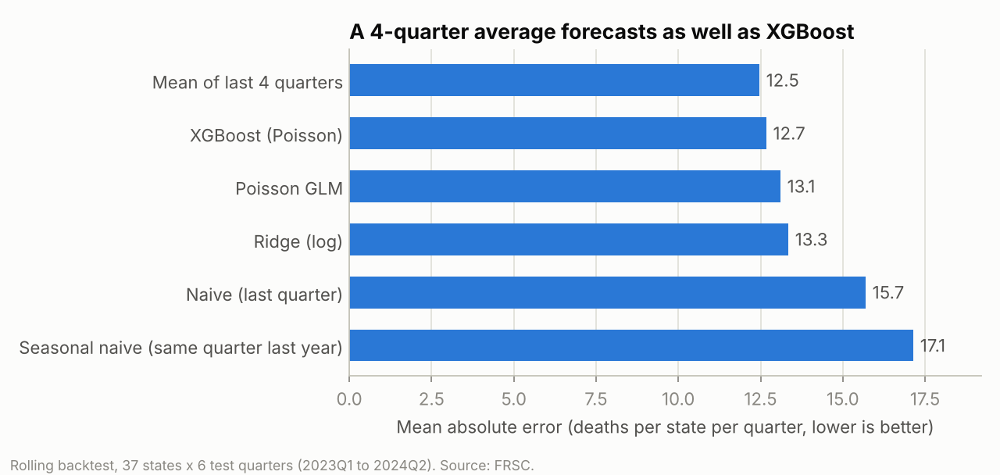
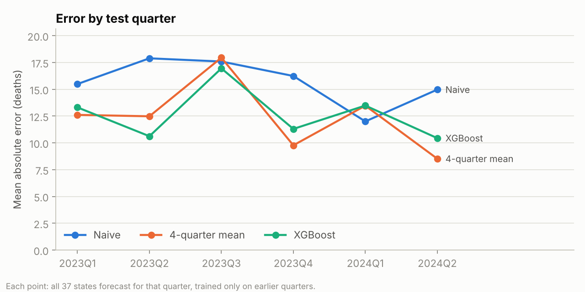
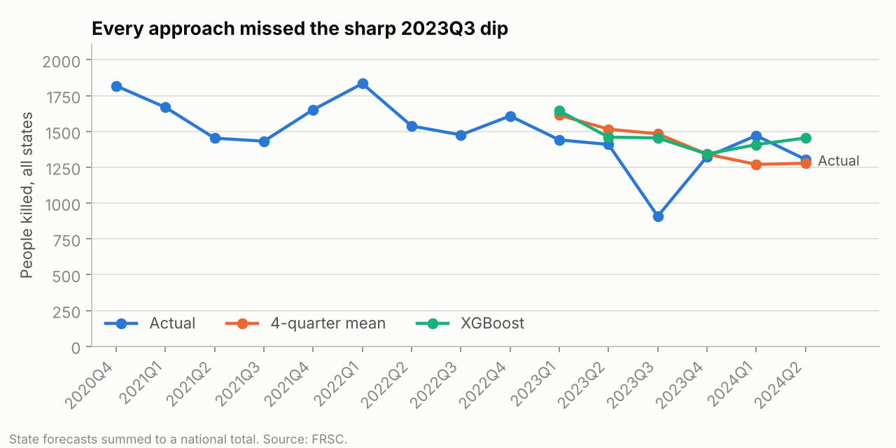
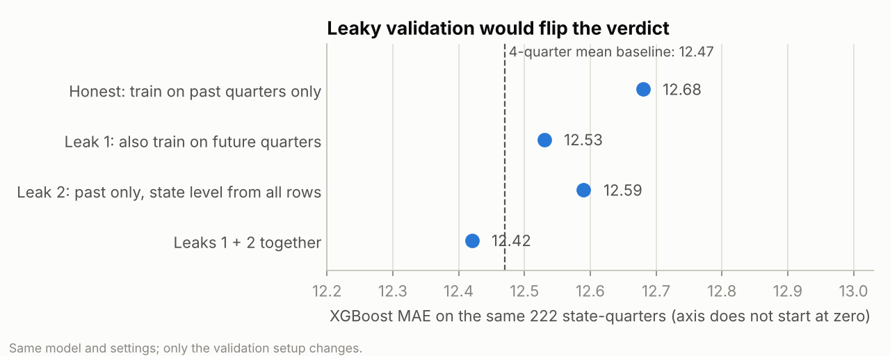

# Forecasting next-quarter road deaths in Nigeria's 36 states and FCT

Can a state's crash record this quarter tell us how many people will die on its roads next quarter? This project tests that with Federal Road Safety Corps (FRSC) data from Q4 2020 to Q2 2024, comparing simple baselines with Ridge regression, a Poisson GLM and XGBoost under a leakage-safe rolling backtest.

**Headline result:** a plain average of the last four quarters forecasts as well as XGBoost. Both cut error by about 20% against the "same as last quarter" baseline, and the difference between them is not distinguishable from zero. A careless validation setup would have reversed that verdict.



## Why this matters

Road deaths are a budget and service-delivery question as much as a safety one. A reliable state-level forecast lets budget monitors and road safety bodies flag where next quarter's burden is likely to fall. Just as important is knowing when a complex model adds nothing, so a simpler, more explainable method can be used with confidence.

## Data

- **Source:** FRSC state crash returns, as published in the quarterly Road Transport Data reports. Quarterly figures for 36 states plus FCT, Q4 2020 to Q2 2024 (15 quarters, 555 state-quarters).
- **Fields per state-quarter:** fatal, serious and minor crashes; total crashes; people injured; people killed; people involved.
- **Raw input:** `data_raw/aggregate_values.json` (the source sheet exported as values).
- **Clean panel:** `data/crashes_state_quarter.csv`, built by `src/prepare_data.py`.

### Data quality, checked rather than assumed

All findings are written to `data/data_quality_report.md`. In short:

1. The source sheet has 19 side-by-side blocks, but only the first 15 are quarters. The last four are yearly totals. The script checks that each one equals the sum of its quarters exactly, then drops them so nothing is counted twice.
2. Borno 2021Q3 has a blank "killed" value. It is recovered as the national total minus every other state (18).
3. Benue 2021Q3 reports total casualties of 113, but injured plus killed is 162. The column is recomputed and is not used as a model feature.
4. For every quarter, the states sum exactly to the national row for deaths.

## Method

**Target:** people killed in a state in quarter T.

**Features**, all known at the end of quarter T-1:

| Feature | Meaning |
|---|---|
| `killed_lag1`, `killed_lag2` | deaths one and two quarters before |
| `killed_lag4` | deaths in the same calendar quarter a year before |
| `killed_mean4` | average deaths over the last four quarters |
| `fatal_crashes_lag1`, `total_crashes_lag1`, `injured_lag1`, `people_involved_lag1` | last quarter's crash profile |
| `killed_per_fatal_crash_lag1` | severity: deaths per fatal crash last quarter |
| `state_level` | the state's average quarterly deaths, learned from training rows only |
| `is_q2`, `is_q3`, `is_q4` | calendar quarter of T (known in advance) |

**Models:**

| Model | Notes |
|---|---|
| Naive | next quarter = this quarter |
| Seasonal naive | next quarter = same quarter last year |
| Mean of last 4 quarters | simple smoothing baseline |
| Ridge (log) | Ridge on `log1p(deaths)`, alpha chosen by internal CV on training rows |
| Poisson GLM | count model with log link |
| XGBoost (Poisson) | `count:poisson`, depth 3, 300 trees, learning rate 0.03 |

Hyperparameters were fixed before looking at test results and were not tuned on the test quarters.

### Validation: rolling-origin backtest

For each of the last six quarters (2023Q1 to 2024Q2), every model is trained only on rows whose target quarter comes earlier, then forecasts all 37 states. That gives 222 out-of-sample forecasts per model, made the way the model would be used in practice.

### Leakage safeguards

- Every feature for quarter T comes from quarters up to T-1; `tests/test_no_leakage.py` checks this directly.
- `state_level` is computed inside each fold from training targets only. A test confirms that changing the test targets does not change it.
- Imputation and scaling are fitted inside scikit-learn pipelines, so they only ever see training rows.
- The backtest asserts that no training target is at or after the test quarter.

## Results

| Model | MAE | RMSE | Bias | MAE vs naive |
|---|---:|---:|---:|---:|
| Mean of last 4 quarters | **12.47** | 17.73 | +2.91 | -20.6% |
| XGBoost (Poisson) | 12.68 | **17.20** | +4.08 | -19.2% |
| Poisson GLM | 13.11 | 17.38 | +6.95 | -16.5% |
| Ridge (log) | 13.35 | 17.71 | +5.77 | -15.0% |
| Naive (last quarter) | 15.70 | 20.46 | +1.36 | 0.0% |
| Seasonal naive | 17.15 | 24.45 | +6.53 | +9.2% |

MAE and RMSE are in deaths per state per quarter. Bias is the mean of (forecast minus actual).

**Paired comparisons** on the same 222 state-quarters, with 95% intervals from a bootstrap over states (a state's errors are correlated across quarters, so resampling single rows would understate uncertainty):

- 4-quarter mean vs naive: **-3.23** deaths per state-quarter (-4.33 to -2.18). A clear improvement.
- XGBoost vs naive: **-3.01** (-4.12 to -1.91). A clear improvement.
- XGBoost vs 4-quarter mean: **+0.22** (-0.53 to +0.95). No detectable difference.



### What the models learned

In XGBoost, 60% of the total gain comes from just two features: the state's typical level (34%) and its 4-quarter average (26%). Last quarter's fatal crashes and injuries add a little more. In other words, the model has largely taught itself to average, which is why it ends up close to the simple baseline.

### Where every model fails



Recorded deaths fell from 1,409 in 2023Q2 to 908 in 2023Q3, then bounced back to 1,323. The fall shows up across most states and in crash counts as well as deaths. It may be real or a reporting gap; this data cannot tell which. No model that relies on recent history can anticipate a break like this, and it is the single worst quarter for every approach. All the learned models also lean high on average (positive bias) as deaths drifted down after 2022.

## The leakage experiment

To show why the validation design matters, `src/leakage_demo.py` repeats the XGBoost evaluation with two common mistakes, scoring each variant on exactly the same 222 state-quarters:



| Validation | XGBoost MAE | vs honest |
|---|---:|---:|
| Honest: train on past quarters only | 12.68 | 0.0% |
| Leak 1: also train on future quarters (what shuffled K-fold does) | 12.53 | -1.3% |
| Leak 2: past only, state level computed from all rows | 12.59 | -0.7% |
| Both leaks together | 12.42 | -2.1% |

The leakage is small here because the lag features already carry most of the signal. Even so, it is enough to make XGBoost (12.42) appear to beat the 4-quarter mean (12.47), which would lead to the wrong conclusion. Small leaks matter most when models are close.

## Limitations

- **Short history.** 15 quarters per state means only 407 trainable rows and six test quarters. The results are honest but noisy.
- **No exposure measure.** Without traffic volume, vehicle counts or population, the models forecast counts, not risk rates.
- **Reporting effects.** Some swings, such as 2023Q3, may reflect how FRSC commands report rather than what happened on the roads.
- **Definition of the target.** "Killed" is as recorded by FRSC. The source does not say whether it counts deaths at the scene only or within a set period after the crash, so comparisons with other countries need care.

## Possible next steps

- Add exposure (population, registered vehicles) and model deaths per 100,000 people.
- Partial pooling (a hierarchical Poisson model) to borrow strength across states with small counts.
- Prediction intervals (quantile or conformal) so forecasts come with an honest range.
- Link to state road budget and project delivery data to study fiscal and safety outcomes side by side.

## How to run

```bash
pip install -r requirements.txt
bash run_all.sh        # prepare data, backtest, leakage demo, charts, tests
```

Or step by step:

```bash
python src/prepare_data.py
cd src && python backtest.py && python leakage_demo.py && python make_charts.py && cd ..
python -m pytest -q tests
```

`notebooks/walkthrough.ipynb` runs the same pipeline with tables and charts inline.

## Project structure

```
data_raw/aggregate_values.json   source sheet, values only
data/crashes_state_quarter.csv   clean state-quarter panel
data/data_quality_report.md      every data issue found and how it was handled
src/prepare_data.py              raw sheet to tidy panel, with checks
src/features.py                  leakage-safe feature table
src/backtest.py                  rolling-origin backtest, metrics, paired bootstrap
src/leakage_demo.py              the deliberate-leakage experiment
src/make_charts.py               figures for this README
tests/test_no_leakage.py         tests that features never look ahead
results/                         predictions, metrics, comparisons
figures/                         charts
notebooks/walkthrough.ipynb      end-to-end walkthrough
```

## Author

Victor Ifeoluwa Odetayo, AI and Data Analyst, Lagos. [LinkedIn](https://linkedin.com/in/ifejs)
